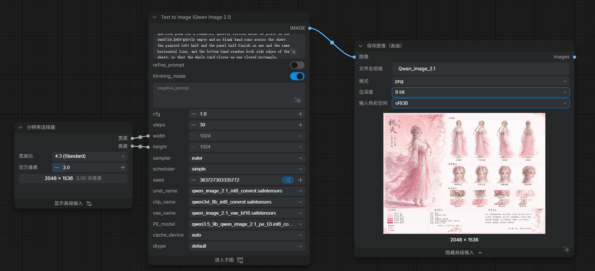

# skills-project

**简体中文** · [English](README_EN.md)

> 把一段人物设定，编译成一份可直接出图的「多面板角色参考卡」英文提示词。

[](LICENSE)
[](#快速开始)
[](#快速开始)


---

## 这是什么

`skills-project` 是一个 **Agent Skill 集合仓库**，收录可直接被多智能体调用的技能。目前收录 1 个技能：`qwen-image-multi-role`。

### 它解决什么问题

用 Qwen-Image 2.1 出一张「角色参考卡」（同一张图里同时有全身立绘、三视图、表情展示、细节展示和属性栏）时，难的从来不是画，而是**把版面写成模型听得懂的一段话**：几格、每格的格名、每格拍什么、中文文案怎么排、哪里必须留白。写一次能出对，换个人物常常整版崩掉。

本项目把这个版面固化下来，拆成两层：

- **一份 12 段模板**（`references/template-en.txt`）—— 版式的单一事实源，只含 `{{占位符}}`，不含任何具体角色；
- **79 个变量字段** —— 换角色只换值，不动模板。

收敛判据不是「看起来像」，而是**逐字符比对**：4 套已验收变量渲染出的提示词，与人工验收通过的原稿完全一致（忽略换行形式）。所以新角色只要把值填对，版式就不会跑偏。

---

## 目录结构

```
skills-project/
├── LICENSE                                 MIT 协议
├── README.md / README_EN.md                中文 / 英文说明
├── CHANGELOG.md
├── tools/install.py                        安装 / 同步技能到 Agent 技能目录
├── doc/
│   ├── examples-overview.jpg               六位角色总览
│   └── qwen-image-multi-role.jpg           ComfyUI 参考出图配置
├── examples/
│   └── qwen-image-multi-role/              成品图 + 对应提示词（一一成对）
│       ├── 01紫嫣.jpg   ·  01紫嫣角色多视图.txt
│       │   …
│       └── 06凌霜.jpg   ·  06凌霜角色多视图.txt
└── skills/
    └── qwen-image-multi-role/              ← 技能本体
        ├── SKILL.md                        自包含入口，可被多智能体直接调用
        ├── references/
        │   ├── template-en.txt             12 段定稿模板（单一事实源）
        │   └── examples/                   4 份原稿 + 2 个变量示范 + 2 份对照
        └── scripts/
            ├── render_prompt.py            JSON → 提示词（体检 + 渲染）
            ├── verify_presets.py           三关回归（改模板后必跑）
            └── presets/                    4 套已验收变量
```

---

## 快速开始

### 安装

技能是纯文本目录，**零第三方依赖**（只用 Python 标准库）。把技能目录复制进 Agent 的技能目录即可：

```bash
# WorkBuddy 用户级技能（macOS / Linux）
cp -r skills/qwen-image-multi-role ~/.workbuddy/skills/
```

```powershell
# Windows PowerShell
Copy-Item -Recurse skills\qwen-image-multi-role "$env:USERPROFILE\.workbuddy\skills\"
```

也可以用仓库自带的同步脚本（推荐：它只拷贝有变化的文件，并能直接告出两边是否已经漂移）：

```bash
python tools/install.py              # 安装 / 更新到 ~/.workbuddy/skills
python tools/install.py --check      # 只比对不写入；有差异时退出码 2
python tools/install.py --to <目录>   # 指定目标技能目录
python tools/install.py --prune      # 同时删除目标里已从仓库移除的文件
```

> **注意**：安装位置是仓库的**副本**，不是符号链接 —— 两边会各自漂移。改完 `skills/` 下的内容记得跑一次 `install.py`，或用 `--check` 在提交前确认一致。

装好后直接用自然语言说就行 —— 例如：

> 按紫嫣那种多视图，做一个叫「墨隐」的角色，主题是墨蓝·笔·藏书境·守卷人，男性

技能会被自动匹配并产出一份 79 字段变量表 + 一份可直接粘贴出图的提示词。

### 生成一份提示词

```bash
cd skills/qwen-image-multi-role

# ① 体检：缺字段 / 数组项数不对 / 表情重名 / HEX 格式错 / 占位符残留，全部拦下
python scripts/render_prompt.py --json 我的角色.json --check

# ② 出行：单行版（换行写成字面 \n，可直接粘进生图节点）
python scripts/render_prompt.py --json 我的角色.json --escape --out 我的角色多视图.txt

# ③ 分段可读版（给人看）：去掉 --escape
python scripts/render_prompt.py --json 我的角色.json
```

其他命令：

```bash
python scripts/render_prompt.py --list-presets             # 列出内置预设
python scripts/render_prompt.py --preset zhiyan --escape   # 直接用预设出提示词
python scripts/render_prompt.py --init > 新角色.json        # 生成空白变量表（81 键）
python scripts/verify_presets.py                           # 改模板后必跑
```

### 三条路径

| 你要做什么 | 走哪条路 |
|---|---|
| **换一个新角色**（最常用） | 复制 `scripts/presets/zhiyan.json` → 改值 → 体检 → 出行。**不要碰模板** |
| 主题色系完全没有参考 | 按 `SKILL.md` §3 的推导链，从「主题三件套」派生出全部 79 个字段 |
| 只想看效果 | `--preset zhiyan`（或 `feifeng` / `heyan` / `taoyao`） |

---

## 技能要点

### 79 个字段分八组

题款（图内中文） / 纸与版 / 画境 / 人物 / 武器与动作 / 格名与格内描述 / 底栏三栏 / 收束。左列是 JSON 字段名，也就是模板里的占位符名。

> **口径**：69 个平铺字段 + 4 条表情描述 + 6 个数组 = **79 个字段**，数组逐项展开是 **100 个取值**。另有 **10 个字段由脚本派生**（头饰从句 4 个 + 代词 6 个），不用写进 JSON。

### `gender` 一键换性别

只改这一个字段，代词、人物总称、年龄从句主语、中文代词全部跟着换：

| gender | 主格 | 所有格 | 宾格 | 中文 | 人物总称 |
|---|---|---|---|---|---|
| `female`（默认） | she | her | her | 她 | …immortal **woman** |
| `male` | he | his | him | 他 | …immortal **man** |
| `neutral` | they | their | them | TA | …immortal **figure** |

自己写的文案（`hold_action`、`age_desc` 这类自由文本）若想跟着换性别，用令牌：

| 令牌 | 含义 |
|---|---|
| `{s}` / `{S}` | 主格（句首大写） |
| `{p}` / `{P}` | 所有格（句首大写） |
| `{o}` | 宾格 |
| `{T}` | 中文代词 |
| `{V:原形}` | 动词第三人称单数，脚本按性别自动取舍 |

> `neutral`（they）必须用 `{V:hold}` 这种写法，否则会渲染出 `They holds` 这类病句。直接写死 `her` / `she` 不报错，但体检会点名告警。

### 三处可以整项留空的槽

`crown` / `earrings` / `ankle` 是全卡**仅有的三个可空槽**。留空即「这位不戴」—— 第 5 段的穿戴句、第 7 段后视图的 `the back of …`、第 8 段表情板的 `one …` 会**自动摘掉对应从句**，既不留空位，也不蹦断句。

### 防「写死」的三道防线

从样例集抽模板时，**样例共有的属性最容易被误当常量写死** —— 而且这类假常量与真骨架肉眼无法区分。本项目为此设了三道**可执行**的防线：

| 防线 | 作用 |
|---|---|
| `FIXATION_WATCH` 写死探针 | 骨架里出现 `flower crown` / `moon-white` / `she` / `her` 等角色词 → `--check` 返回码 2 |
| 派生字段（10 个） | `crown` → `crown_noun` → 后视图与表情板从句；`gender` → 6 个代词字段 |
| `verify_presets.py` 三关回归 | ① 4 套预设与原稿逐字符一致 ② 31 项换装检查（摘头饰 / 换非花冠头饰 / 翻男相 / 翻中性）③ 防线自检（故意写死与非法令牌，必须被拦下） |

**判据（比修复本身更值钱）**：一句话里的某个名词，换个角色就说不通了，而它在模板里不是 `{{占位符}}` —— 那就是写死。详见 `SKILL.md` §6.6。

---

## 出图环境参考



| 项 | 值 |
|---|---|
| 分辨率 | 2048 × 1536（4:3，约 3.0 MP） |
| unet | `qwen_image_2.1_int8_convrot.safetensors` |
| clip | `qwen3vl_4b_int8_convrot.safetensors` |
| vae | `qwen_image_2.1_vae_bf16.safetensors` |
| PE model | `qwen3.5_9b_qwen_image_2.1_pe_t2i_int8_...` |
| 采样 | cfg 1.0 / steps 30 / euler / simple |
| thinking_mode | 开启 |

---

## 示例角色

| # | 角色 | 主题三件套 | 兵器 | 伴生 | 图 / 提示词 |
|---|---|---|---|---|---|
| 01 | 紫嫣 | 紫藤 · 幻蝶灵境·守梦人 | 箫 | 幻蝶 | [JPG](examples/qwen-image-multi-role/01紫嫣.jpg) · [TXT](examples/qwen-image-multi-role/01紫嫣角色多视图.txt) |
| 02 | 绯枫 | 枫红 · 丹枫灵境·守秋人 | 剑 | 绯蝶 | [JPG](examples/qwen-image-multi-role/02绯枫.jpg) · [TXT](examples/qwen-image-multi-role/02绯枫角色多视图.txt) |
| 03 | 禾晏 | 秋收黄 · 丰谷灵境·守穗人 | 笛 | 金雀 | [JPG](examples/qwen-image-multi-role/03禾晏.jpg) · [TXT](examples/qwen-image-multi-role/03禾晏角色多视图.txt) |
| 04 | 桃夭 | 桃粉 · 桃梦花境·牵缘人 | 扇 | 粉蝶 | [JPG](examples/qwen-image-multi-role/04桃夭.jpg) · [TXT](examples/qwen-image-multi-role/04桃夭角色多视图.txt) |
| 05 | 素雪 | 冰雪蓝 · 寒山灵境·守雪人 | 纸伞 | 白鹤 | [JPG](examples/qwen-image-multi-role/05素雪.jpg) · [TXT](examples/qwen-image-multi-role/05素雪角色多视图.txt) |
| 06 | 凌霜 | 冰霜蓝 · 霜华灵境·守剑人 | 剑 | 霜鹤 | [JPG](examples/qwen-image-multi-role/06凌霜.jpg) · [TXT](examples/qwen-image-multi-role/06凌霜角色多视图.txt) |

> **关于提示词文件的形态**：`examples/` 下的 `.txt` 保留了各自产出时的原始形态，没有为了整齐而改写 —— `01 / 05 / 06` 是可直接粘贴出图的**单行转义版**（换行写作字面 `\n`），`02 / 03 / 04` 是 **12 段可读版**。两者正文内容一致，渲染脚本用 `--escape` 控制输出哪一种。

其中 **01–04 是经人工验收的原稿**，模板与变量契约就是从它们反推出来的；**05–06 是后续新增的示范**，用来验证模板对新角色是否成立（`05素雪` 试了新的兵器名词 `umbrella` 和第二种年龄从句写法，`06凌霜` 试了高束马尾、指定右手持械、以及 `crown` 留空＝不戴头饰）。

> **一句实话**：仓库里证明的是「文本层面对了」—— 渲染出的提示词与验收原稿逐字符一致、换掉关键属性后句子依然成立。它**不等于**出图效果已被验收。新角色（尤其是不戴头饰或换性别的）建议先跑一次再批量。

---

## 许可

[MIT](LICENSE) © 2026 cxq

**协议范围**：MIT 覆盖本仓库的**代码与文档**（模板、脚本、说明文字）。

**关于示例图**：`examples/` 与 `doc/` 下的角色设定卡由 Qwen-Image 2.1 生成，用于演示技能效果，其角色设定由使用者提供。若要二次使用这些图片，请自行确认角色设定与生成模型的授权范围。
