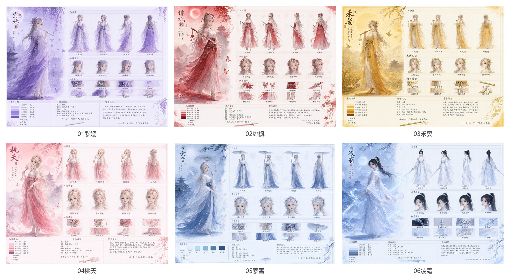

# skills-project

[简体中文](README.md) · **English**

> A collection of Agent Skills that multi-agent systems can invoke directly. Plain text, zero dependencies, copy-and-go.

[](LICENSE)
[](#installation)
[](#installation)

---

## What this is

`skills-project` is a repository of **Agent Skills**. Each skill is a self-contained directory under `skills/`, with a `SKILL.md` entry point. **No personal paths, no dependency on any particular agent platform** — copy a skill folder into whatever skill directory your agent reads and it works.

Currently shipping **1** skill:

| Skill | What it does | Entry point |
|---|---|---|
| [qwen-image-multi-role](#skill-qwen-image-multi-role) | Compiles a short character brief into a production-ready prompt for a multi-panel character reference card | `skills/qwen-image-multi-role/SKILL.md` |

---

## Installation

A skill is a plain text directory with **zero third-party dependencies** (Python standard library only). Copy the skill folder into the skill directory used by your agent:

```bash
# macOS / Linux
cp -r skills/qwen-image-multi-role <your-skill-directory>/
```

```powershell
# Windows PowerShell
Copy-Item -Recurse skills\qwen-image-multi-role "<your-skill-directory>\"
```

> Different agents read skills from different places (a dot-directory under your home folder, a directory inside the project, …). Put it wherever your agent expects. **This repository assumes no particular location.**

Or use the bundled sync script — it only copies what changed, and can tell you whether the two copies have already drifted:

```bash
python tools/install.py --to <your-skill-directory>            # install / update
python tools/install.py --to <your-skill-directory> --check     # compare only; exit code 2 on drift
python tools/install.py --to <your-skill-directory> --prune     # also remove files deleted from the repo

# Set an environment variable once to skip repeating the path
export AGENT_SKILLS_DIR=<your-skill-directory>   # PowerShell: $env:AGENT_SKILLS_DIR="..."
python tools/install.py --check
```

> **Note**: the installed location is a **copy** of the repo, not a symlink — the two can drift apart. After editing anything under `skills/`, run `install.py`, or use `--check` before committing.

Once installed, just ask in natural language — for example:

> Make another multi-view sheet like Zhiyan's, for a character called 墨隐 — ink-blue theme, a brush, keeper of a scripture vault, male

The skill is matched automatically and returns a 79-field variable table plus a prompt ready to paste into the generation node.

---

## Repository conventions

```
skills-project/
├── LICENSE
├── README.md / README_EN.md              Chinese / English
├── CHANGELOG.md
├── tools/install.py                      Install / sync skills into your agent's skill directory
├── skills/
│   └── <skill-name>/                     ← the skill itself (this is what gets installed)
│       ├── SKILL.md                       Required: self-contained entry point with YAML frontmatter
│       ├── references/                    Optional: templates, samples, other read-only assets
│       └── scripts/                       Optional: scripts (keep them dependency-free)
├── examples/
│   └── <skill-name>/                     ← that skill's example outputs (not installed)
└── doc/
    └── <skill-name>/                     ← images used by that skill's README chapter
```

**The one convention: all three directories are named after the skill.** The skill name appears in four places and they must agree — the `skills/<skill-name>/` directory name, the `name` in `SKILL.md`'s frontmatter, `examples/<skill-name>/`, and `doc/<skill-name>/`.

Two more rules:

- **Skills never reference each other.** Each `skills/<skill-name>/` is self-contained; the installer copies directories wholesale and never stitches across them.
- **No absolute paths inside `SKILL.md`.** Scripts locate themselves via `__file__`, so they run from wherever the skill was installed.

### Adding a new skill

1. Create `skills/<skill-name>/SKILL.md` with YAML frontmatter (`name` and `description` are required).
2. Add `references/` (templates / samples) and `scripts/` if you need them.
3. Put example outputs in `examples/<skill-name>/` and README images in `doc/<skill-name>/`.
4. Add a row to the table in "What this is" above, and a chapter below named `## Skill: <skill-name>` (copy the shape of the existing chapter — it does not need to be elaborate).
5. Run `python tools/install.py --to <your-skill-directory>` to install.

> `tools/install.py` discovers every directory under `skills/` that contains a `SKILL.md`, so **adding a skill requires no script changes**. To install just one: `--skill <skill-name>`.

---

## Skill: qwen-image-multi-role

> Turn a short character brief into a production-ready English prompt for a multi-panel character reference card.



### The problem it solves

Generating a *character reference card* with Qwen-Image 2.1 — a single image that contains a full-body portrait, three-view sheet, expression sheet, detail sheet and an attribute column — is not hard because of the art. It is hard because **the layout has to be written as one paragraph the model can follow**: how many cells, what each cell is called, what each cell shows, how the Chinese text is arranged, and where whitespace is mandatory. Get it right once, and the next character breaks the whole sheet.

This skill freezes that layout into two layers:

- **A 12-paragraph template** (`references/template-en.txt`) — the single source of truth for the layout. It contains only `{{placeholders}}`, never a concrete character.
- **79 variable fields** — changing characters means changing values, never the template.

The convergence criterion is not "looks about right" but **character-by-character comparison**: prompts rendered from the four validated variable sets are byte-identical to the human-approved originals (ignoring newline style). Fill the values in correctly and the layout cannot drift.

### Render a prompt

```bash
cd skills/qwen-image-multi-role

# 1. Validate: missing fields / wrong array lengths / duplicate expressions /
#    malformed hex codes / leftover placeholders — all rejected
python scripts/render_prompt.py --json my_character.json --check

# 2. Emit the single-line version (newlines become literal \n, ready to paste)
python scripts/render_prompt.py --json my_character.json --escape --out my_character.txt

# 3. Emit a readable, multi-paragraph version: drop --escape
python scripts/render_prompt.py --json my_character.json
```

Other commands:

```bash
python scripts/render_prompt.py --list-presets             # list built-in presets
python scripts/render_prompt.py --preset zhiyan --escape   # render from a preset
python scripts/render_prompt.py --init > new_char.json     # blank variable table (81 keys)
python scripts/verify_presets.py                           # run after editing the template
```

### Three ways in

| Goal | Path |
|---|---|
| **Add a new character** (most common) | Copy `scripts/presets/zhiyan.json` → edit values → validate → render. **Do not touch the template** |
| No colour reference at all | Follow the derivation chain in `SKILL.md` §3 to derive all 79 fields from a "theme triad" |
| Just want to see the output | `--preset zhiyan` (or `feifeng` / `heyan` / `taoyao`) |

### 79 fields in eight groups

Title block (in-image Chinese) / paper & layout / painted scene / character / weapon & pose / cell names & cell descriptions / bottom three columns / closing. Field names double as the template's placeholder names.

> **Counts**: 69 flat fields + 4 expression descriptions + 6 arrays = **79 fields**, expanding to **100 values**. Another **10 fields are derived by the script** (4 headwear clauses + 6 pronoun fields) and must not be written into the JSON.

### `gender` switches everything at once

Change one field and the pronouns, the subject noun, the age clause subject and the Chinese pronoun all follow:

| gender | subject | possessive | object | Chinese | Subject noun |
|---|---|---|---|---|---|
| `female` (default) | she | her | her | 她 | …immortal **woman** |
| `male` | he | his | him | 他 | …immortal **man** |
| `neutral` | they | their | them | TA | …immortal **figure** |

For your own free text (`hold_action`, `age_desc`, …) use tokens so it switches too:

| Token | Meaning |
|---|---|
| `{s}` / `{S}` | subject (capitalised) |
| `{p}` / `{P}` | possessive (capitalised) |
| `{o}` | object |
| `{T}` | Chinese pronoun |
| `{V:base}` | third-person singular verb, chosen from the gender |

> `neutral` (they) **must** use `{V:hold}`-style tokens, otherwise you get ungrammatical output like `They holds`. Hard-coding `her` / `she` will not error, but validation reports it by name.

### Three slots you may leave empty

`crown` / `earrings` / `ankle` are the **only three omittable slots** in the whole card. Empty means "this character wears none" — the dressing clause in paragraph 5, `the back of …` in the rear-view paragraph and `one …` in the expression sheet **drop their clauses automatically**, leaving neither a hole nor a broken sentence.

### Three defences against hard-coded attributes

When a template is extracted from a set of samples, **properties shared by every sample are the ones most likely to be mistaken for constants** — and such false constants are indistinguishable from the real skeleton by eye. This skill therefore ships three **executable** defences:

| Defence | What it does |
|---|---|
| `FIXATION_WATCH` tripwire | A character word or pronoun in the skeleton (`flower crown`, `moon-white`, `she`, `her`, …) makes `--check` exit with code 2 |
| 10 derived fields | `crown` → `crown_noun` → rear-view and expression-sheet clauses; `gender` → 6 pronoun fields |
| `verify_presets.py` — 3 gates | (1) the 4 presets stay byte-identical to the originals (2) 31 variation checks (drop headwear / swap to a non-floral headpiece / flip to male / flip to neutral) (3) defence self-test — deliberate hard-coding and illegal tokens must be caught |

**The criterion (worth more than the fix itself)**: if a noun in a sentence stops making sense for a different character, and it is *not* a `{{placeholder}}` in the template — it is hard-coded. See `SKILL.md` §6.6.

### Reference generation setup


| Item | Value |
|---|---|
| Resolution | 2048 × 1536 (4:3, ~3.0 MP) |
| unet | `qwen_image_2.1_int8_convrot.safetensors` |
| clip | `qwen3vl_4b_int8_convrot.safetensors` |
| vae | `qwen_image_2.1_vae_bf16.safetensors` |
| PE model | `qwen3.5_9b_qwen_image_2.1_pe_t2i_int8_...` |
| Sampling | cfg 1.0 / steps 30 / euler / simple |
| thinking_mode | on |

### Example characters

| # | Character | Theme triad | Weapon | Companion | Image / prompt |
|---|---|---|---|---|---|
| 01 | Zhiyan 紫嫣 | Wisteria · Dream-Butterfly Realm, Dream Keeper | flute | violet butterflies | [JPG](examples/qwen-image-multi-role/01紫嫣.jpg) · [TXT](examples/qwen-image-multi-role/01紫嫣角色多视图.txt) |
| 02 | Feifeng 绯枫 | Maple-crimson · Maple Realm, Autumn Keeper | sword | crimson butterflies | [JPG](examples/qwen-image-multi-role/02绯枫.jpg) · [TXT](examples/qwen-image-multi-role/02绯枫角色多视图.txt) |
| 03 | Heyan 禾晏 | Harvest-yellow · Grain Valley, Grain Keeper | flute | golden sparrows | [JPG](examples/qwen-image-multi-role/03禾晏.jpg) · [TXT](examples/qwen-image-multi-role/03禾晏角色多视图.txt) |
| 04 | Taoyao 桃夭 | Peach-pink · Peach Blossom Realm, Fate Weaver | fan | pink butterflies | [JPG](examples/qwen-image-multi-role/04桃夭.jpg) · [TXT](examples/qwen-image-multi-role/04桃夭角色多视图.txt) |
| 05 | Suxue 素雪 | Ice-snow blue · Snow Mountain Realm, Snow Keeper | paper umbrella | white cranes | [JPG](examples/qwen-image-multi-role/05素雪.jpg) · [TXT](examples/qwen-image-multi-role/05素雪角色多视图.txt) |
| 06 | Lingshuang 凌霜 | Frost blue · Frost Peak Realm, Sword Keeper | sword | frost cranes | [JPG](examples/qwen-image-multi-role/06凌霜.jpg) · [TXT](examples/qwen-image-multi-role/06凌霜角色多视图.txt) |

> **About the prompt files**: the `.txt` files under `examples/` keep the original form each one was produced in, rather than being rewritten for tidiness — `01 / 05 / 06` are the **paste-ready single-line form** (newlines written as literal `\n`), `02 / 03 / 04` are the **readable 12-paragraph form**. The content is identical; `--escape` on the render script picks which one you get.

**01–04 are the human-approved originals** — the template and the field contract were reverse-engineered from them. **05–06 are later demos**, added to check that the template holds for a new character (`05 Suxue` exercises a brand-new weapon noun `umbrella` and a second form of the age clause; `06 Lingshuang` exercises a high ponytail, a specified right hand, and an empty `crown`).

> **One honest caveat**: what this repository proves is that the *text layer* is correct — the rendered prompts are byte-identical to the approved originals, and the sentences still hold after swapping key attributes. It does **not** mean the rendered artwork has been approved. For a new character (especially one without headwear, or a different gender) render once before batching.

---

## License

[MIT](LICENSE) © 2026 cxq

**Scope**: MIT covers the **code and documentation** in this repository (template, scripts, prose).

**About the example images**: the character sheets under `examples/` and `doc/` were generated with Qwen-Image 2.1 to demonstrate the skill, from character briefs supplied by the user. If you intend to reuse those images, check the licensing of the character designs and of the generating model yourself.
